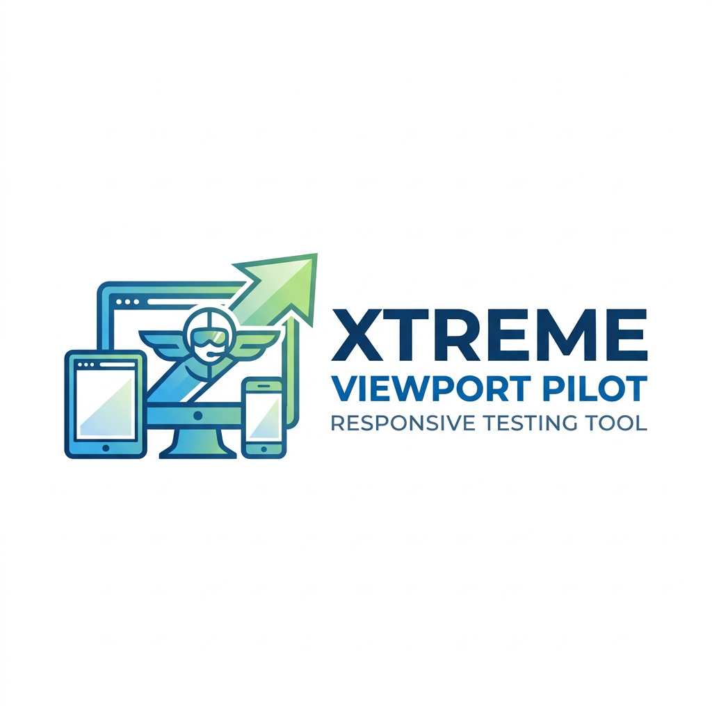

# Xtreme Viewport Pilot

**The layout broke at 768 px. You found out because someone sent a screenshot from their phone.**

  

 

## The wall

Responsive work means resizing one window, checking, resizing again, and trying to remember what the last size looked like. DevTools covers a lot, but you're still switching profiles by hand and losing the comparison.

Viewport Pilot opens the same page in two to four synced device windows, side by side, with the viewport, pixel ratio, platform, and touch behavior you choose.

## What changes

**A device library instead of manual sizes.** Curated profiles for common viewports, browsers, and platforms. No rebuilding the same iPhone profile in every session.

**LAB mode.** Two to four synchronized windows in parallel, so a breakpoint failure is visible at 360, 768, and 1440 at the same moment instead of three separate passes.

**Conditions beyond screen size.** Network throttling and CPU pressure, because a layout that survives on an idle desktop can still fall apart on a slow connection.

**Location behavior.** Built-in cities or exact coordinates for anything that branches on geography.

**Profiles you define once.** Viewport, DPR, platform, User-Agent, touch, pointer, and media-query signals combined into a reusable profile, exported as JSON when you need to hand it to someone else.

**Two working modes.** Open a dedicated device window, or adapt the current tab when you'd rather keep context.

**Rotate and keep testing.** Orientation switch plus compact floating controls that stay out of the way.

## Who it's for

Front-end developers checking breakpoints. Designers reviewing a layout against three devices before a client call. QA writing reproducible viewport cases instead of "looks wrong on mobile."

## Get it

Current builds go to supporters directly rather than through a public download button. Process and delivery steps: [SUPPORT.md](SUPPORT.md)

Support the work: [Ko-fi](https://ko-fi.com/pacosalasv) · [PayPal](https://www.paypal.com/paypalme/pacosalas?locale.x=en_US&country.x=MX) (include the product name and your delivery email in the note)

Bugs and requests: [open an issue](https://github.com/pacosalasv/Xtreme_Viewport_Pilot-Support/issues)

  

